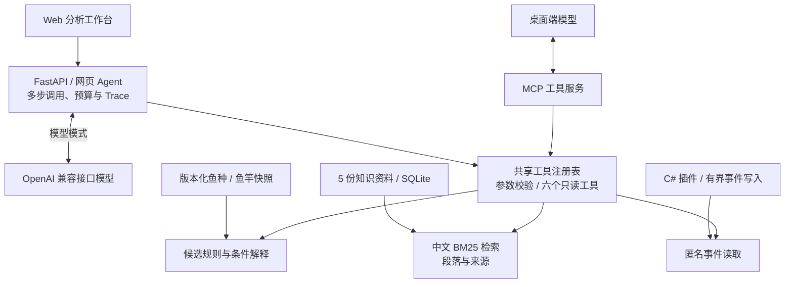
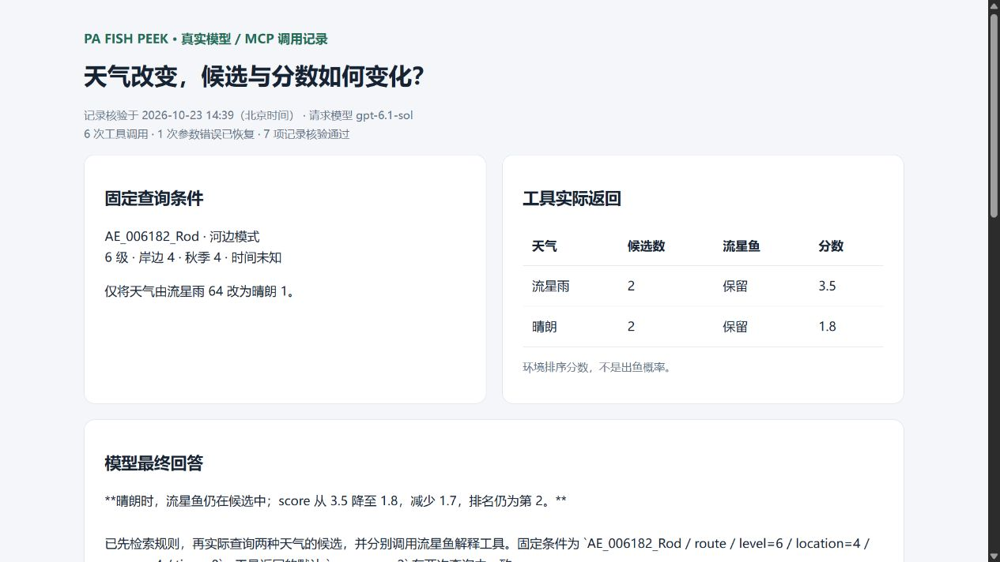

# 四季小屋（PA Fish Peek）｜基于 MCP 与 RAG 的领域智能分析助手

围绕钓鱼领域的候选筛选、条件解释与知识问答，将结构化规则、中文检索、只读 MCP 工具和 Agent 多步调用连接起来。用户可以通过自然语言提问，核对候选条件、比较环境变化，并追溯回答依据。

技术栈：**Python · FastAPI · SQLite · MCP SDK · BM25 · Tool Calling · C# · GitHub Actions**。

[启动工作台](#启动分析工作台) · [真实调用演示](docs/mcp-demo.md) · [检索评测](docs/retrieval-evaluation.md) · [插件安装](#安装与按键)

## 系统能力

| 模块 | 实现 |
| --- | --- |
| 领域规则与数据 | 76 种鱼、17 个精确鱼竿档案；白名单、等级、地点和季节校验，环境评分与排除原因解释 |
| MCP 工具服务 | 六个只读工具，共享参数校验与领域执行逻辑，支持桌面模型调用 |
| RAG 知识检索 | 5 份资料、21 个有效段落；中文字符与双字词 BM25、错误码规范化、段落来源引用 |
| 网页 Agent | OpenAI 兼容接口、多步 Tool Calling、执行预算、超时与错误恢复、Trace 记录 |
| 评测与交付 | Windows/Linux CI、领域回归、检索指标对照与退化检查、C# 插件构建和直接安装打包 |

## 系统架构



规则工具负责精确候选与数值计算，检索提供说明和来源，模型结合工具结果组织解释。[设计决策](docs/engineering-decisions.md)说明了这三部分的分工、只读接口及失败处理；[技术设计](docs/technical-design.md)提供完整执行链路。

## 真实模型调用演示

固定鱼竿、等级、钓点与季节，只将天气从流星雨改为晴朗。模型经 MCP 检索依据、查询两种天气的候选并解释结果：流星鱼仍被保留，环境排序分数由 **3.5 降至 1.8**。



记录保留全部 6 次调用，包含一次参数越界后恢复、5 次成功调用及带来源的最终回答。[完整演示](docs/mcp-demo.md)提供复现命令、原始事件核验方法与可展开的工具记录。桌面 MCP 演示和网页兼容接口验证分别记录。

## 验证与检索迭代

以下自动化检查与检索评测记录对应代码提交 [`53169ec`](https://github.com/Ushiroyu/PA-Fish-Peek/commit/53169eca4b87033afe61cc734bfe45e99adedaf6)。

| 检查项 | 记录 |
| --- | --- |
| Python 自动测试 | 71 项通过，Windows / Ubuntu CI 均通过 |
| 领域与检索回归 | 原有 26 项检查通过 |
| 检索评测 | 60 条离线场景问句，覆盖直接提问、同义表达、简称标识、多段依据、条件缺失和无直接答案 |
| 错误码规范化对照 | 同资料、同问题集下，Recall@4：94% → 96%；MRR@4：0.8450 → 0.8517 |

检索指标按 50 条有相关段落标签的样例计算，另有 10 条无直接答案样例单独观察。评测保留相关性依据与待复核排名，支持复现改动前后的差异，并由 CI 检查参考指标是否退化。

[评测报告与指标口径](docs/retrieval-evaluation.md) · [逐条检索记录](docs/evaluation/retrieval-report.md) · [双平台 CI 记录](https://github.com/Ushiroyu/PA-Fish-Peek/actions/runs/39920526218) · [模型与实机验证范围](docs/validation.md)

## 插件与工作台版本

底层 BepInEx IL2CPP 插件读取钓鱼遭遇信息，显示玩家、钓点与等级，并结合鱼竿档案和环境信息给出候选。匿名遭遇通道与工作台规则查询分别记录，便于对照与诊断。

插件版本 `2.8.16.58`，工作台版本 `0.1.0`。提供配套运行时、直接安装目录、中文检索、MCP 工具与 Agent 查询流程。

[工作台与 Codex 接入](docs/workbench.md) · [技术设计](docs/technical-design.md) · [验证与验收](docs/validation.md) · [后续规划](docs/roadmap.md)

## 游戏插件功能

| 能力 | 当前实现 |
| --- | --- |
| 遭遇提示 | 读取 `fishJustEncounteredParam`，排队处理并显示等级信息 |
| 玩家范围 | 关闭 / 仅自己 / 所有玩家；昵称未就绪时，所有玩家模式使用临时玩家标签 |
| 候选鱼种 | 优先精确鱼竿档案，否则使用模式与轻重竿分类白名单，结合等级和地点筛选 |
| 环境排序 | 季节、时间、天气参与候选评分；池塘候选还检查季节 |
| 秋季适配 | 包含秋季鱼竿、鱼种和流星雨天气相关调整 |
| 故障处理 | callback / setter 原生 detour 禁用，保留弱句柄、限长队列和诊断日志 |

“可能是”表示规则候选。排序分数没有经过概率校准，不等于服务器真实出鱼概率，也不保证唯一识别鱼种。

## 启动分析工作台

```powershell
pwsh -NoProfile -File .\scripts\start-workbench.ps1
```

打开 `http://127.0.0.1:8768`。首次启动脚本准备独立 Python 环境，需要 Python 3.11+。普通插件安装仍按下面步骤直接解压启动。

使用 Codex 桌面端官方登录时，在另一终端执行：

```powershell
pwsh -NoProfile -File .\scripts\install-mcp.ps1
```

重新加载 MCP 或打开新会话，即可让桌面端已选模型使用 `fishpeek` 工具分析。示例问题、可选兼容接口配置和开发命令见[工作台说明](docs/workbench.md)。

## 安装与按键

1. 退出游戏，备份已有 `BepInEx`、`dotnet` 和根目录加载器文件。
2. 在仓库页面选择 **Code → Download ZIP**，打开 ZIP 最外层的 `PA-Fish-Peek-main` 文件夹。
3. 将里面的内容解压或复制到游戏主程序所在的根目录，不要把整个外层文件夹放进去。
4. 正常启动游戏，进入钓鱼场景，按 `F10` 开启预测输出。

```text
游戏根目录/
├─ 游戏原有文件
├─ .doorstop_version
├─ doorstop_config.ini
├─ winhttp.dll
├─ dotnet/
└─ BepInEx/
   ├─ core/
   ├─ interop/
   ├─ unity-libs/
   ├─ config/BepInEx.cfg
   └─ plugins/PAFishPeek/PAFishPeekPlugin.dll
```

| 按键 | 作用 |
| --- | --- |
| `F10` | 开启 / 关闭预测输出，默认关闭 |
| `F11` | 切换关闭、仅自己、所有玩家三种显示范围 |

F10 关闭输出后，已经启用的轮询仍会继续运行；完全停用需退出游戏并移走插件 DLL。`src`、`docs` 和开发脚本不参与游戏启动。

附带运行时是与本项目环境配套的 BepInEx 6 IL2CPP、CoreCLR、Unity `2022.3.62` 库和 Interop，依赖具体游戏版本。游戏更新后需要重新验证。配套配置允许更新 Interop，首次启动或更新后可能触发生成或下载。

## 构建与打包

开发需要 Windows、PowerShell 7 和能构建 `net6.0` 的 .NET SDK。随包 `dotnet` 是游戏加载器运行时，不是开发 SDK。

```powershell
# 仓库根目录执行：默认引用仓库配套 DLL，不写入游戏目录
pwsh -NoProfile -File .\scripts\build.ps1

# 可选：引用本地游戏目录的依赖
pwsh -NoProfile -File .\scripts\build.ps1 -GameRoot 'C:\Games\GameRoot'

# 明确更新仓库安装目录内的插件，然后打包并检查
pwsh -NoProfile -File .\scripts\build.ps1 -UpdateBundledPlugin
pwsh -NoProfile -File .\scripts\package.ps1
pwsh -NoProfile -File .\scripts\check-package.ps1 -Path .\artifacts\PA-Fish-Peek-direct-install.zip
```

生成的安装 ZIP 没有外层文件夹，可直接解压到游戏根目录。打包只收集指定运行时和插件，排除源码、日志与扫描缓存。

默认打包使用仓库已有的插件 DLL。需要本次构建结果时先执行上面的 `-UpdateBundledPlugin`；再次打包若输出已存在，请用 `-OutputPath` 指定新文件名。

仓库提供 GitHub Actions 构建与打包工作流；具体云端执行结果以 **Actions** 页面为准。构建和包检查不能替代进游戏验收。

## 故障排查

| 现象 | 优先检查 |
| --- | --- |
| 没有加载日志 | 加载器位置、是否解压多了一层、Doorstop 是否启用 |
| 加载但没有鱼信息 | 钓鱼场景、F10、F11 范围，以及控制器发现和遭遇读取日志 |
| 显示“玩家数字” | 昵称解析过程中使用的临时玩家 ID 标签 |
| 更新后闪退 | 退出并恢复备份，核对游戏、Interop、BepInEx 和插件版本 |

日志：`BepInEx/LogOutput.log`。反馈时提供版本、场景、操作和脱敏日志。历史访问冲突涉及 `GameAssembly.dll + 0xc1f7a9 / 0xc0000005`；禁用 detour 不等于所有原生调用风险已消除。

## 工程交付

| 项目 | 内容 |
| --- | --- |
| 实现与交付 | 已有源码、配套运行时、构建入口和直接安装打包流程 |
| 实机试用 | 2026-10-17 有秋季小屋进入、F10、控制器发现、资源表和晴朗天气读取记录 |
| 自动化检查 | GitHub Actions 完成云端构建、打包、安装结构检查与产物上传 |

项目覆盖运行时集成、领域数据处理、规则推断与故障诊断。详细检查结果见验证文档。

## 文档

- [工作台、RAG、MCP 与 Agent 接入](docs/workbench.md)
- [技术设计与执行链路](docs/technical-design.md)
- [真实模型与 MCP 完整调用演示](docs/mcp-demo.md)
- [关键设计决策](docs/engineering-decisions.md)
- [中文检索评测与对照结果](docs/retrieval-evaluation.md)
- [验证记录与实机验收](docs/validation.md)
- [后续规划](docs/roadmap.md)
- [2026-10-17 数据与天气审计](docs/fishpeek-data-audit-20261017.md)
- [开发与贡献](CONTRIBUTING.md)
- [第三方组件](docs/third-party.md)
