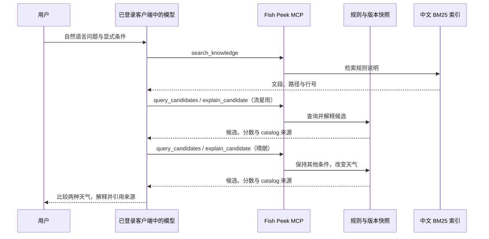

# 模型与 MCP 完整调用演示

## 演示问题

固定鱼竿 `AE_006182_Rod`、河边模式、6 级、岸边 `4`、秋季 `4`、时间未知 `0`，只将天气从流星雨 `64` 改成晴朗 `1`：流星鱼是否仍在候选中，排序分数如何变化？

该场景同时需要中文规则检索、结构化候选查询、鱼种解释和来源引用。天气是排序信号，很适合核对模型是否把环境条件误当成硬过滤。

## 调用链路



## 在本机复现

已准备工作台环境且本机官方客户端完成登录后，在仓库根目录运行：

```powershell
.\.venv\Scripts\python.exe scripts\run-mcp-demo.py --model gpt-6.1-sol --output artifacts\mcp-demo-run
```

模型标识以本机账号可用列表为准。脚本通过官方客户端复用现有登录，临时只配置 `fishpeek` MCP，要求其初始化成功；工具服务不读取登录凭据。此命令会实际调用模型并使用对应账号额度。接入依据为 [OpenAI 官方非交互执行说明](https://learn.chatgpt.com/docs/non-interactive-mode)与 [MCP 配置说明](https://learn.chatgpt.com/docs/extend/mcp)。

运行输出包括：

| 文件 | 内容 |
| --- | --- |
| `events.jsonl` | 本机客户端原始事件流，保留本地排查 |
| `client.log` | 本机客户端诊断输出 |
| `weather-demo.json` | 通过核验的工具参数、结果、来源和最终回答 |
| `weather-demo.html` | 可直接打开、展开查看工具记录的静态演示页面 |

只检查已有记录时，可使用 `--from-events artifacts\mcp-demo-run\events.jsonl`；该模式会标记为已有记录核验，不重新请求模型。输出目录默认被 Git 忽略，公开记录需单独检查后纳入文档。

脚本核对：模型完成事件、工具范围、两种天气的查询与解释、查询条件保持一致、工具结果与版本快照一致、回答来源存在以及分数说明。遇到未恢复的参数错误、工具失败、条件改变或未知来源时，脚本返回非零退出码。

## 实际演示记录

2026-10-23 使用本机 ChatGPT 登录，通过官方客户端请求 `gpt-6.1-sol` 完成该场景。原始事件中的 `mcp_tool_call`、最终回答与用量返回均已保留用于核验。

| 天气 | 候选数量 | 流星鱼是否保留 | 流星鱼排序分数 |
| --- | ---: | --- | ---: |
| 流星雨 `64` | 2 | 是 | 3.5 |
| 晴朗 `1` | 2 | 是 | 1.8 |

模型引用了 `knowledge/fishing.md:L3`、`L7`、`L11`、`L15` 和 `catalog:plugin-2.8.16.58:流星鱼`，说明分数变化不代表出鱼概率，也不推断实际游戏时间。

首次运行覆盖了参数错误恢复：模型请求检索 8 条，内部校验返回 `invalid_arguments`，随后模型使用有效请求继续完成分析。该现象用于补齐 MCP 对外 Schema 中的条数上下限，并增加协议回归检查。

修正后的完整调用仍观察到一次越界请求：模型请求 8 条，MCP 的 Schema 校验直接拒绝，模型改用 6 条检索并完成后续查询。公开记录保留全部 **6 次调用，其中 5 次成功、1 次参数错误后恢复**，没有删去错误步骤。该结果也说明，对模型声明参数范围不能代替服务端校验。

公开记录见[演示摘要](examples/weather-demo.json)与[静态回放页面](examples/weather-demo.html)。在本机打开 HTML 可展开每次工具输入和输出；页面展示已完成的调用记录，不会自动发起新的模型请求。


## 演示时的讲解顺序

1. 先展示固定查询条件，明确只改变天气。
2. 展开中文检索调用，指出段落来源与行号。
3. 对照两次候选与解释工具返回，说明硬条件和排序信号的区别。
4. 展示模型最终回答，核对数值与引用。
5. 结合[设计决策](engineering-decisions.md)解释只读工具、BM25、参数约束与错误恢复。

本场景验证模型、MCP 与版本数据快照的完整调用，输入条件由演示问题提供；游戏实时遭遇和现场识别另按实机验收记录核对。
