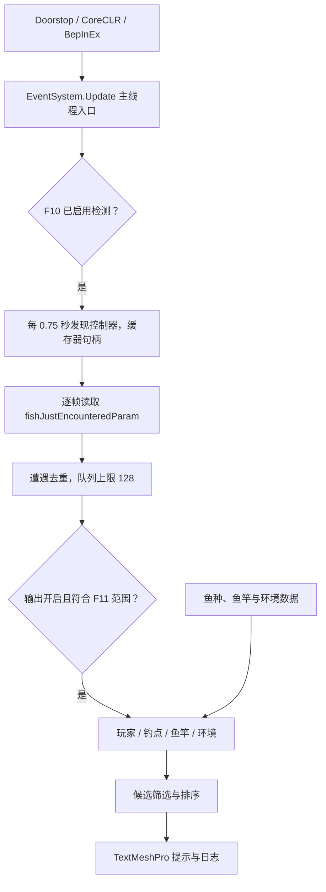

# 技术设计

本文描述当前 `2.8.16.57` 实现；未来方案见[路线图](roadmap.md)。

## 执行链路

单独的 Mermaid 文件：[fishpeek-callflow.mmd](fishpeek-callflow.mmd)。旧图描述托管观察器，现按当前主线程原生轮询路径修正。

## 源码职责

| 文件 | 职责 |
| --- | --- |
| `FishPeekPlugin.cs` | 生命周期、主线程驱动、控制器发现、原生读取、玩家映射、队列、热键与 UI |
| `FishPeekPlugin.ContextPrediction.cs` | 数据处理、上下文、鱼竿识别、地点缓存与候选计算 |
| `FishLevelData.cs` | 内置鱼等级表 |
| `FishContextData.cs` | 内置鱼种环境和地点权重 |
| `RodFishCategoryData.cs` | 模式与轻重竿分类白名单 |
| `BuiltInExactRodProfilesData.cs` | 精确鱼竿档案，通过 UID、GUID 或名称查找 |

这些文件通过 `partial` 共同组成插件类。

## 候选推断

1. 从遭遇读取等级，结合玩家和钓点缓存建立上下文。
2. 优先精确鱼竿档案，否则使用模式与轻重竿分类白名单。
3. 等级和地点参与筛选；池塘还要求季节匹配。
4. 季节、时间、天气匹配数及地点权重参与排序。
5. 无候选时保留玩家、地点和等级基础提示。

天气主要是评分信号，不能概括为所有鱼都经过天气硬过滤；分数也不是出鱼概率。

精确鱼竿候选为空时，可能重试不指定地点；分类候选为空时可能尝试另一种轻重竿分类。这些放宽分支提升提示覆盖率，也带来候选解释的需要。后续应记录原始上下文、回退原因与候选排除原因。

## 数据处理

鱼种名称在等级、环境、分类和精确鱼竿档案之间保持一致。秋季适配与三组历史名称修正见[数据与天气审计](fishpeek-data-audit-20261017.md)。候选生成包含默认值与回退分支，调试时需要结合实际上下文核对。

## 运行边界

当前 `EnableNativeEncounterHook=false`，但 `EnableNativeEncounterPolling=true`。轮询仍包含 IL2CPP 方法发现、调用和原生内存读取；弱句柄、内存页检查和主线程执行不能证明生命周期和原生调用始终安全。原生访问冲突也不能依赖普通 `try/catch` 保证恢复。

F10 关闭输出后，已启用的轮询继续运行。昵称未就绪时所有玩家模式使用临时标签；地点存在缓存或模式默认值回退，展示值不一定都来自当前帧直接观测。

日志与局部计数器用于跟踪控制器发现、遭遇处理和候选筛选。Interop 更新和 Unity 库下载行为受配套 BepInEx 配置控制。
