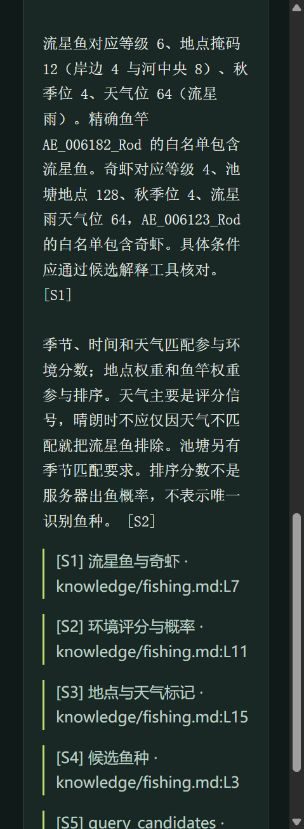

# 钓鱼分析工作台

工作台将候选规则、中文检索、MCP 与工具调用问答连接起来。鱼种和鱼竿计算直接使用插件内置表生成的版本快照，安装时随代码附带。

完整调用的输入、工具记录、模型回答和复现脚本见[真实模型演示](mcp-demo.md)；规则与检索的分工、只读工具和失败处理见[设计决策](engineering-decisions.md)。

## 在 Codex 桌面端使用

在仓库根目录准备环境并注册本机工具：

```powershell
pwsh -NoProfile -File .\scripts\start-workbench.ps1
# 另开终端，注册 MCP；可用 -GameRoot 指定游戏安装目录
pwsh -NoProfile -File .\scripts\install-mcp.ps1
```

重新加载 MCP 服务或打开新的 Codex 会话后，使用桌面端已选的模型提问。例如：

> 使用 fishpeek 工具分析：AE_006182_Rod，河边模式，6 级鱼，岸边地点 4，秋季 4，流星雨天气 64。为什么候选有流星鱼？如果改成晴朗天气，结果怎样？回答注明工具结果与知识来源。

Codex 的账号登录和模型选择由桌面端管理；Fish Peek MCP 只提供本地只读工具，不读取桌面端登录凭据。该方式直接使用现有 Codex 登录，不需要给项目填写 API 密钥。配置方式参见 [OpenAI 官方 MCP 文档](https://learn.chatgpt.com/docs/extend/mcp)。

## 浏览器工作台

运行启动脚本后打开 `http://127.0.0.1:8768`。侧栏设置鱼竿、等级、地点、季节和天气；可以计算候选、检索说明，或读取匿名遭遇。页面展示来源与调用记录，查询条件和实际事件分别显示。

本地模式使用规则计算和检索段落组织结果。通过兼容接口接入模型后，网页可执行模型选择工具、多步调用与带引用的回答。



## 可选的兼容接口

将 `assistant/.env.example` 复制为 `assistant/.env`，填写：

```dotenv
FISHPEEK_BASE_URL=https://your-provider.example/v1
FISHPEEK_MODEL=your-tool-capable-model
FISHPEEK_API_KEY=your-local-key
```

接口使用 Chat Completions 的 `tools` / `tool_calls` 协议，需要服务端模型支持该协议。密钥仅保存在本机环境变量或 `.env`，不会进入仓库、网页或 Trace。参考 [OpenAI 工具调用协议](https://developers.openai.com/api/docs/guides/function-calling)。

`FISHPEEK_MAX_STEPS`、`FISHPEEK_MAX_TOOL_CALLS`、`FISHPEEK_MAX_TOKENS` 和超时配置用于限制单次执行。模型临时错误最多重试一次，重复工具循环、无效参数和错误引用均有明确错误码。

## MCP 工具

| 工具 | 用途 |
| --- | --- |
| `list_rods` | 查询精确鱼竿档案 |
| `query_candidates` | 根据显式条件计算候选与环境分数 |
| `explain_candidate` | 解释鱼种的匹配、排除原因和环境信号 |
| `search_knowledge` | 检索中文说明段落并返回来源 |
| `inspect_weather` | 解释天气位，保留未知值 |
| `read_runtime_events` | 读取最近匿名遭遇事件 |

服务同时提供 `fishing_analysis` 提示模板。MCP 使用[官方 Python SDK](https://github.com/modelcontextprotocol/python-sdk)，工具声明为只读，无任意命令、路径或游戏操作参数。

## RAG 与规则的分工

中文知识按标题分段，存入 SQLite；检索使用中文单字、双字词及英文标识的 BM25 评分。检索结果附段落来源，模型结合这些段落和规则工具结果生成回答。答案引用 ID 由服务分配，并在返回前检查引用标识。

规则工具对 76 种鱼、17 个精确鱼竿档案执行等级、地点、白名单及池塘季节筛选，再按环境分数排序。条件以调用输入为准，便于解释和复现；工作台不会自动改竿型或放宽地点。插件画面的原有兼容分支与工作台严格查询分别保留。

## 匿名遭遇通道

插件 `2.8.16.58` 在既有遭遇处理链路上记录匿名快照，后台使用 128 条有界队列写入，单个文件达到 4 MiB 时轮转。记录包含临时玩家标识、时间、等级、体型和场景，不包含昵称、账号或原生指针。

在 BepInEx 配置的 `Workbench / WriteAnonymousEvents` 中可控制事件记录。工作台默认读取同项目安装目录的事件位置；游戏安装在其他位置时，通过 `FISHPEEK_EVENTS_FILE` 配置。没有实际事件时页面显示空列表，样例不会填入真实事件列表。

## 开发与验证

```powershell
python -m venv .venv
.\.venv\Scripts\python.exe -m pip install -r assistant\requirements.lock
.\.venv\Scripts\python.exe -m pip install --no-deps -e assistant
python scripts\export-catalog.py --check
.\.venv\Scripts\python.exe -m pytest assistant\tests -q
.\.venv\Scripts\python.exe -m fishpeek.evaluate --output artifacts\evaluation.json
dotnet run --project tests\EventJournal\EventJournal.csproj -c Release
```

`scripts/export-catalog.py` 从插件内置表同步快照；CI 使用 `--check` 检查数据一致性。完整依赖版本锁定在 `assistant/requirements.lock`。

FastAPI 提供 `/api/health`、`/api/tools`、`/api/chat` 和 `/api/traces/{id}`；接口文档位于 `/docs`。Trace 保存工具名称、状态和耗时，最多保留 1000 次记录，便于排查错误与循环。服务默认仅监听本机地址，验证请求来源与 Host。

## 容器入口

```powershell
docker compose up --build
```

Compose 将端口映射到本机 `127.0.0.1:8768`，运行状态写入独立卷，事件目录只读挂载。容器使用非 root 用户。
